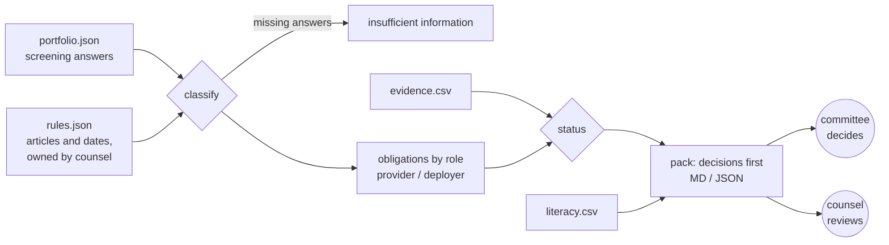

# ai-act-readiness

[](https://github.com/flam7791/ai-act-readiness/actions/workflows/ci.yml) [](LICENSE) 

**An AI Act readiness pack for an executive committee: which AI uses to stop, which obligations
are already late, what the high-risk programme needs, and where AI literacy falls short.**

An insurer's AI portfolio runs from underwriting scores to a staff assistant. The AI Act applies
in stages: prohibitions and AI literacy since February 2025, transparency duties since August
2026, and high-risk requirements for Annex III uses from December 2027, after the 2026
amendment. Life and health insurance pricing is named in Annex III. This MVP turns three exports
(the use-case portfolio with screening answers, an evidence log and literacy coverage) into a pack
that opens with the decisions the committee owns, and shows for every use case the answers and
articles each proposal rests on, so counsel can check it.

> Independent portfolio project. Northwind Assurance is fictional and every data row is synthetic.
> Classifications are proposals for legal review, not legal advice.

## Read it as a product case (about 10 minutes)

| Question | Where |
|---|---|
| What problem, for whom, and how sure are we? | [Discovery](docs/product/01-discovery.md): personas from the chief data and AI officer to use-case owners, four falsifiable hypotheses, what is not known |
| What exactly is built, and not built? | [PRD](docs/product/02-prd.md): goal, non-goals, requirements, status rules, success metrics, risks |
| Where does it go next, and when do we stop? | [Roadmap and pilot](docs/product/03-roadmap-and-pilot.md): two committee cycles, decision rules fixed before launch |
| Which choices could be questioned? | [Decision log](docs/product/04-decision-log.md): proposals not verdicts, derogations to counsel, literacy target as policy, never "compliant" |
| Which articles and dates? | [Legal basis](docs/legal-basis.md): every rule with its article, role and application date, as amended in 2026 |
| What does a team get on day one? | [Team brief](docs/team/team-brief.md) with RACI, [backlog](docs/team/backlog.csv), [working agreement](docs/team/working-agreement.md), PR template |
| Is "done" real? | [Traceability](docs/team/traceability.md): every Done story is proved by a named test, and CI fails otherwise |
| How would it run in a pilot? | [OPERATIONS.md](OPERATIONS.md): release gate, monitoring, incident runbook |

## See it

The [full sample pack](docs/sample-report.md) opens like this:

> **Decisions for the executive committee**
>
> 1. **Stop or redesign** UC05 (Call-centre voice sentiment for agent coaching): the screening matches a prohibited practice, applicable since 2 February 2025.
> 2. **Close overdue obligations now:** UC04 TR-INTERACT (Art. 50(1)).
> 3. **Ask counsel to confirm the Art. 6(3) derogation** for UC08; plan as high-risk until it is confirmed.
> 4. **Fund the high-risk programme:** 3 systems, 31 of 34 obligations open, first due 2 December 2027 (13 months left).
> 5. **Complete the screening** for UC11 before it progresses: no category is proposed on missing answers.
> 6. **AI literacy:** 3 role groups below the 80% internal target, including staff who operate high-risk systems (Life and health underwriters 67%, Recruiters and hiring managers 32%).

The sample portfolio is built to show every answer the tool can give: a life and health
underwriting score that is high-risk and needs a fundamental rights impact assessment (UC01); a
premium-personalisation model whose owner claims it is only "preparatory", rejected because it
profiles people (UC09); a tariff checker whose narrow-task claim goes to counsel (UC08); a vendor
CV-screening tool with deployer duties only (UC06); voice sentiment analysis of call-centre agents,
which is prohibited (UC05); a customer assistant already late on telling people they are talking
to an AI (UC04); fraud signals that are not high-risk despite profiling (UC03); and a proposal with half its screening answered, which gets no category at all (UC11).

## Quick start

```bash
pip install -e ".[dev]"
ai-act-readiness classify --portfolio data/sample/portfolio.json
ai-act-readiness report --portfolio data/sample/portfolio.json --evidence data/sample/evidence.csv \
  --literacy data/sample/literacy.csv --as-of 2026-11-04 --out out
# open out/readiness-2026-11-04.md
pytest -q && python tools/trace.py
```

## How it works



| Proposed category | Rule (from the screening answers) |
|---|---|
| Prohibited | an Art. 5 practice, including emotion recognition at the workplace; overrides everything else |
| High-risk | an Annex III use, unless a derogation applies; a derogation never applies to profiling |
| Not high-risk, Art. 6(3) claimed | an Annex III use where the owner claims a derogation ground and there is no profiling: counsel decides |
| Transparency obligations | no Annex III use, but the system talks to people, generates content, publishes deep fakes or recognises emotions |
| Minimal risk | none of the above, every question answered |
| Insufficient information | any question unanswered or any code unknown |

Status is red for a prohibited use or an obligation past its date without evidence, amber for open
obligations, a derogation in review or missing answers, green when every applicable obligation has
evidence with a reference.

## Design decisions

- **Proposals, not verdicts.** Every result carries the screening answers and articles behind it
  (D1); the pack never says "compliant" or "certified", and a test enforces it (D9).
- **A blank is not a "no".** Missing answers give insufficient information, not minimal risk (D2).
- **Derogations go to counsel.** The tool never accepts an Art. 6(3) claim, and rejects it where
  the system profiles people (D3).
- **The literacy target is policy, not law.** Since 2026, Art. 4 asks for measures, not a
  guaranteed level, and the pack says so (D4).
- **Rules in one versioned file**, readable by counsel, with the date it was checked (D5).

All entries: [decision log](docs/product/04-decision-log.md).

## Companion projects

[ai-adoption-tracker](https://github.com/flam7791/ai-adoption-tracker) gives the same kind of
committee the evidence to scale, iterate or stop each pilot; this repository answers the
regulatory question for the same portfolio. The use-case intake in
[ai-engineering-framework](https://github.com/flam7791/ai-engineering-framework) scores sensitivity
before anything is built.

## How it was built

Context first (a [build spec](docs/build-spec.md) and the discovery), then the loop the user
follows (screen, classify, gather evidence, decide), then acceptance criteria written before code,
then the build, then tests as evaluation: 21 tests, every one tied to a story, all twelve
[evaluation cases](evals/EVALS.md) must-pass and run on every push. The pilot operating model is
in [OPERATIONS.md](OPERATIONS.md); designed for a pilot, operated so far as a prototype on
synthetic data.

## Limitations

- The rules are a reading of the amended Act for screening a portfolio; they are not a substitute
  for counsel, and the Commission's guidelines on high-risk classification (due 2027) may change
  how the Art. 6(3) grounds are read.
- General-purpose AI model provider duties and the Annex I product route are out of scope (US-14).
- Discovery is assumption-led; no interviews were run for this portfolio version.
- Data protection is named where it meets the Act, not assessed.

## Author

Built by Flavio ([@flam7791](https://github.com/flam7791)), who works on enterprise AI adoption and
governance and builds AI automation for SMEs. Product artefacts and MVP by the author; the team
pack is what he would hand to a team taking it to pilot.
